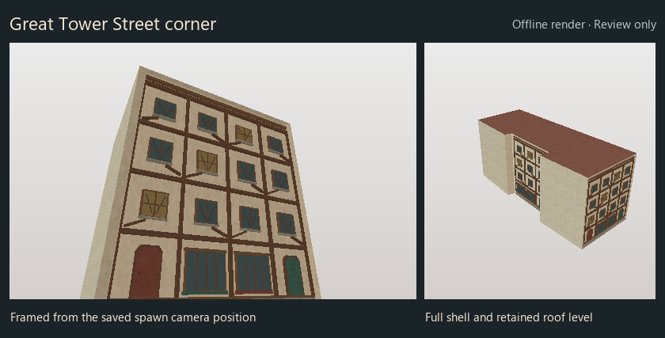
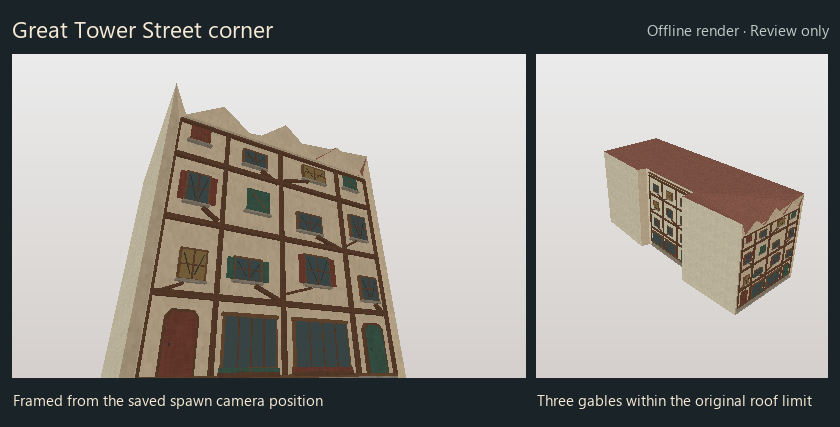

# Great Tower Street opening corner

This complete render model fits the eight-edge shell visible from the Gray London opening spawn. It uses lime plaster, oak half-timbering, a fieldstone plinth, leaded windows and inset shop doors. The flat deck preserves the six source roof triangles at world Z 15.0 m, and the foundation stays at Z 0.2 m. Three closed party walls follow edges 0, 4 and 6. The surface detail stays inside the original shell so existing public routes retain their space.

`Source/SM_GLMedieval_SpawnCorner_Review.obj` uses metres, +X outward toward Great Tower Street and +Z up. Its audit records the world pivot, facing, source and output hashes. The material library resolves its eight diffuse textures through project-relative paths.
The local `.gitattributes` keeps the hashed OBJ and MTL files LF-normalized on
Windows and other checkouts.

The asset is **review only**. It has a closed floor, walls and roof with decorative details, with original tile collision as the reference. The shop doors are visual. The Weigh-House route and saved FirstPage and Frank Dunning story positions keep their existing protections. The original asset, map and story packages have no replacement from this prototype. A live camera, route, floor and actor review is required before authorizing placement. See [opening shell review](../../spawn_first_view_whole_building_review.json).

## Isolated offline renders

The structural study holds the exact flat roof and establishes the measured envelope.



The `VisualStudy` model adds narrower and wider shop bays, staggered window sizes and heights, painted shutters and three street gables merging into the existing flat roof shape. Its render recesses reach world Z 13.1 m while the original collision remains at Z 15.0 m. The apparent roof would sit up to 1.9 m below support in these recesses. Live rooftop traversal and FirstPage camera review are required before using this geometry.



Run from the repository root with the pinned `Saved/CityPCG/Tile_p03_p00.glb` available. The render command uses Pillow. Each preview shows the isolated building from the saved spawn camera position with an illustrative aim, beside an elevated view of the entire model.
The commands create `StructuralModel`, `GabledModel`, `StructuralPreview.png` and `GabledPreview.png` under `Saved/CityPCG/MedievalSurvey/SpawnCornerReproduction`. The test reads the reviewed models in this folder. For another run, pass a new directory to each build and a new PNG path to each render with `--output`. Both commands refuse existing destinations.

```powershell
python -B Tools/CityPCG/build_spawn_corner_prototype.py
python -B Tools/CityPCG/build_spawn_corner_prototype.py --visual-study
python -B Tools/CityPCG/test_build_spawn_corner_prototype.py
python -B Tools/CityPCG/render_spawn_corner_prototype.py
python -B Tools/CityPCG/render_spawn_corner_prototype.py --visual-study
```

The build checks the original roof and party walls, directed edge closure on each mesh part and every triangle against the measured footprint and vertical limits. The test also checks the emitted OBJ and UVs, and exercises open faces, excessive height and concave footprint crossings.
