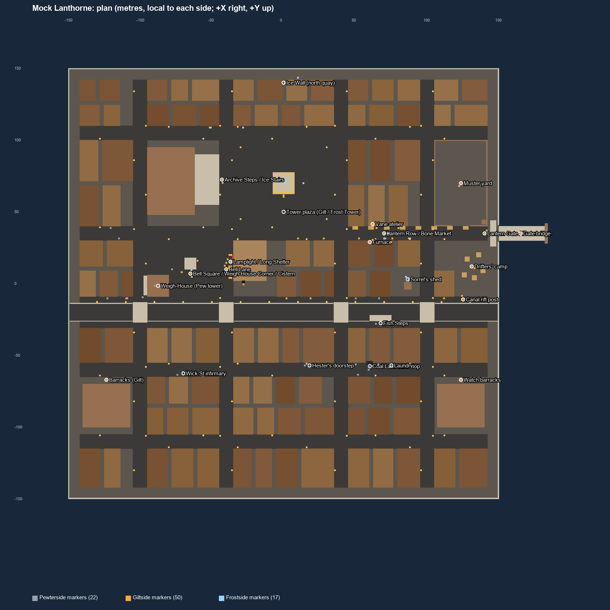

# Mock Lanthorne: a stand-in city until the real map lands

A blockout of Lanthorne, so the whole game loop runs before the real map is ready. That loop is: quest givers, NPC
routines between real places, world jumps, the three towers, three pages and the finale.

When the coworker's map lands, the swap is: place the same named markers, then change the map setting. No code
changes are needed. The checklist is in [Swapping in the real Lanthorne](#swapping-in-the-real-lanthorne).

*`plan.png`: the shared layout in metres, local to each side, drawn from the same script that builds the levels.
Gold dots are street lamps.*

## Files

| Path | What it is |
|---|---|
| `/Game/MockCity/Lvl_MockCity` | **The map to load.** It holds one sun, sky, atmosphere and height fog for all three sides, the `PlayerStart` (Giltside, outside the Lamplight), and a `RecastNavMesh` with runtime generation set to Dynamic. It streams the three sides below as always-loaded offset copies. |
| `/Game/MockCity/Lvl_MockCity_Pewterside` | Pewterside, at level offset X = 0. |
| `/Game/MockCity/Lvl_MockCity_Giltside` | Giltside, at X = +150000 cm (1.5 km). The game starts here. |
| `/Game/MockCity/Lvl_MockCity_Frostside` | Frostside, at X = +300000 cm (3 km). |
| `/Game/MockCity/Materials/MI_Mock_<Side>_<Part>` | Flat colours, one set per side (instances of the engine `BasicShapeMaterial`). |
| `ArtDirection/MockCity/MARKERS.md` | Every story marker name, its side and where it stands. This is the list to copy into the real map. |
| `ArtDirection/MockCity/plan.png` | The layout above. |
| `ArtDirection/MockCity/tools/` | `mockcity_build.py` rebuilds everything, `mockcity_plan.py` redraws the plan, and `mockcity_markers.json` lists every marker name the content uses (from `people.json`, `quests.json`, the cutscenes and the code). |

All three sides share one layout, at the same local coordinates. They are the same city on three sides of the
mirror. That is what lets a world jump keep the hero's exact spot: the jump moves you by the difference between two
sides' `Reflections World Anchor`s, and the anchors sit at each side level's origin.

## The city

The city is a walled island about 300 × 300 m, with water all round and a quay with a low parapet. Invisible
blockers keep the hero in.

- **Streets** are 10 m wide, on a grid: X = -100, -40, 40, 100 and Y = 105, 35, -60, -110.
- **The canal** crosses at Y -26..-14, with a bridge at each X street and walks on both banks.
- **Building blocks** are split into lots with 3 m alleys. Each lot has a door spot on its street face. There are
  102 doors, and the homes markers use them.

| Area (local m) | Giltside | Pewterside | Frostside |
|---|---|---|---|
| Plaza (0, 70) with the tower | **Gilt Tower**: sealed door, page inside | A solid stump with rubble steps (no page) | **Frost Tower**: sealed, page inside, ramps up to the crown arena |
| Square (-65, 10) with a fountain | **Bell Square** (fountain, Jory's fiddle) | **Weigh-House Corner** | **The Cistern** |
| Corner building (-87, -1), 10 m high, stair round the back | (an ordinary roof) | **The Old Weigh-House**: first page on the roof | (an ordinary roof) |
| Big building (-23, 16) on Bell Lane | **The Lamplight** inn (cellar hatch on the south side) | | **The Long Shelter** |
| Lane X = -40, Y 0..30 | **Bell Lane**: three failing lamps 8 m apart | | |
| Archive and steps (-43, 72) | **Archive Steps** | | **Ice Stairs** |
| Row Y = 35, X 45..140, stalls | **Lantern Row** (furnace, Thrale shop, Vane atelier) | | **Bone Market** |
| Gate (145, 35) and its bridge | **Lantern Gate**, Watch post, key | | **Frozen Gate** |
| Quay south of the gate | **Drifters' camp** (under the gate) | | |
| Canal walk (125, -11) | **Canal rift post** | | |
| Canal steps (67, -27) | | **Fish Steps** | |
| Coal Lane (Y = -60, tram rails) | | **Tram stop**, **Hester's doorstep**, **laundry** | |
| (-70, -62) | | **Wick Street infirmary** | |
| Yard (86, 3) | | | **Sorrel's shed** |
| North quay (0, 140) | | | **The Ice Wall** |
| Walled yard (123, 70) | **Muster yard** | | |
| Long blocks (-123, -85) and (123, -85) | Barracks (Lamp Companies), Watch barracks | | Wall Company barracks (marker on the north quay) |

**Mood.** All three sides share the persistent level's single low, warm sun. Each side gets its mood from things
that stay inside its own level:

- its colour set (warm brick and gold, grey stone, bleached ice);
- its street lamps, which are Codex's city lamps: a warm lantern post on every street in Giltside, every other gas
  lamp lit in cold white in Pewterside, and every other brazier stand lit in blue in Frostside;
- a Local Fog Volume over the island (faint amber, grey haze, dense white);
- the anchor's colour grade from `DA_WorldJumpConfig` > Worlds > Grade.

Dressing uses Codex's existing `/Game/LanthorneAssets/<Side>/Props`, one prop per role on each side:

| Role | Pewterside | Giltside | Frostside |
|---|---|---|---|
| Crate | canal crate | archive coffer | provision crate |
| Bollard | canal bollard | marble urn | rune waymarker |
| Shrine | hand pump | mirror pedestal | mirror shrine |

The buildings and street lamps use Codex's city kit (next section). Everything else is still engine blockout shapes:
towers, gate, bridges, stalls, steps and paving.

## The city kit (Codex's facades and lamps)

Every building box is dressed with Codex's facade kit from `/Game/LanthorneAssets/<Side>/City/`: the 102 lot buildings
plus the Weigh-House, the Lamplight, the archive and both barracks. Every street lamp is that side's city lamp:
- Pewterside: a gas lamp.
- Giltside: a lantern post with its arm over the street.
- Frostside: a brazier stand.

How a building is put together (`skin_building` in `tools/mockcity_build.py`):

| Piece | What it does |
|---|---|
| The old box, **invisible** | Collision, with the same footprint as before, so the navmesh and crowd lanes don't move. The hero, camera, traces and spells stop at the facade front. |
| `SM_<Side>_FacadeCorner` | A 4 m block at each corner on every floor, scaled to the module width of its two walls. |
| `SM_<Side>_FacadeGround` | Door modules along the ground floor of the door face (the face the door marker stands in front of). |
| `SM_<Side>_FacadeUpper` | Window modules everywhere else, one per floor. Widths are about 4 m, scaled 0.78–1.21 to fit the wall. Floors are 3.2 m, stretched 0.94–1.25 to fit the box height. |
| `SM_<Side>_FacadeCornice` | A cornice round the top with a 0.25 m overhang. The Weigh-House has none; it keeps its roof parapet. |
| Roof slab | An engine cube in the side's street colour, so a building seen from the Frost crown or a roof isn't hollow. |
| `<Building>_Core` | A visible box 0.6 m inside the facades, with no shadow and no collision. It is the only piece in the Lumen scene, so bounce light keeps working while the facade instances add nothing to the surface cache. |

A side's facades, cornices, roof slabs and lamps are instanced components on a single actor, `CityKit_<Side>`. There
is one Hierarchical Instanced Static Mesh component per piece, with no collision and Lumen off. Instances past 600 m
are culled, so a side never draws the other two, which are at least 1.2 km away. Per side that is 7,330 instances:

| Piece | Instances |
|---|---|
| Corners | 1,452 |
| Window modules | 3,532 |
| Door modules | 200 |
| Cornice pieces | 1,936 |
| Roofs | 107 |
| Lamps | 103 |

The components are added through the editor's subobject system, the same way the Details panel adds them, because
components created with `new_object` are not saved.

Each lamp keeps an invisible 0.25 m collision post on its old spot. Its point light sits at the lamp head: in the
Giltside lantern, at the top of the Pewterside lamp, or in the Frostside bowl.

The real London replaces all of this, and nothing in the swap checklist below depends on the kit.

## The win path (main quest) in the mock

1. **Start: Giltside, outside the Lamplight** (`CutsceneAnchor_Intro`). Two Pewterside shards lie on Bell Lane in
   front of you.
2. Find Ilse on **Lantern Row**, then the burning eyes in **Bell Square**.
3. **Step down to Pewterside** (hold X / Y) and go to **Weigh-House Corner**. Climb the **stair round the back, by
   the drainpipe** (`Tower_Pewterside`) to the roof. **Page 1** is there, with a Giltside shard to get back up.
4. Step up to Giltside on the same roof, then walk down.
5. **The Lantern Gate**: hold it. **The Gilt Tower key** sits on a pedestal by the Watch post.
6. **The Gilt Tower** (`Tower_Giltside`): the key opens the sealed door. **Page 2** is inside, with a Frostside shard.
7. **Step up from inside the Gilt Tower** into the sealed **Frost Tower** (`Tower_Frostside`): **page 3**
   (`CutsceneAnchor_MirrorWhole`). Climb the ramps inside to the **crown**, where the villain arena is
   (`CutsceneAnchor_Ending`). A Giltside shard waits inside and on the crown, so the hero can always step back.

Spare shards: Bell Square and Lantern Row (Giltside), Coal Lane, the square and the Fish Steps (Pewterside), and the
Bone Market (Frostside).

## Play it

In PIE, open the map with the console command `open /Game/MockCity/Lvl_MockCity`, or set it as the PIE map. Useful
console commands:

- `Story.Markers` lists every marker. Auto-placed ones are names the map is still missing.
- `Story.ShowMarkers 1` draws the markers.

## Swapping in the real Lanthorne

1. **Three side maps of your London**, with the same layout at the same local coordinates. Only a pure translation
   is allowed between them: no rotation, no scale. Duplicating one map and re-dressing it per side is the easy way.
2. **In each side map, a `Reflections World Anchor`** at the level origin, with *World* set to its side (Pewterside,
   Giltside or Frostside). Copy it from the mock side level.
3. **One persistent map** that streams the three sides as Always Loaded, with level transforms X 0 / 150000 /
   300000. Any spacing of at least 1.2 km works; the anchors define the jump.
   - The sun, sky and height fog go here, once.
   - So does a `PlayerStart` in Giltside, and a `RecastNavMesh` (built, or runtime generation set to Dynamic).
   - The mock's `Lvl_MockCity` is the template.
4. **Story markers**: drop `Reflections Story Marker` actors with every name in [MARKERS.md](MARKERS.md), on the
   right side. The fastest way is to select a mock side level's markers, copy them, paste them into your side
   level, then move each one to the real spot. Names, extra-name tags, radius and facing travel with them.
5. **The three towers**: keep the win path above.
   - Pewterside: a high roof reached by stairs, with a page on it.
   - Giltside: a tower with a `Reflections Sealed Door` (*Required Key* `GiltTowerKey`), a page inside and a
     Frostside shard.
   - Frostside: the same footprint, sealed from outside, with a page inside and a way up to the crown, plus a
     `Reflections Villain Arena` on the crown.
   - Giltside also needs a `Reflections Key`, somewhere near the Lantern Gate.
   - Pages and shards are `Reflections Book Page` and `Reflections World Coin` pickups. Copy them from the mock.
6. **Navigation**: a `NavMeshBoundsVolume` over the playable area in each side map.
7. **Crowd lanes and squad routes**: ZoneShapes with the `CitySidewalk` lane profile along the pavements, and
   `Reflections Squad Route` actors. Copy them from the mock and re-fit them.
8. **Change the map setting**: point game-flow's New Game map at your persistent map. Nothing else names the mock.
   `DA_WorldJumpConfig` > Worlds > *Map* is only read by the separate-maps fallback.
9. **Check**: in PIE, `Story.Markers` should show **0 auto-placed**. Then play the win path once.

## Rebuilding the mock

The levels are generated by `tools/mockcity_build.py`. Run it in the editor's Python, one step at a time, with
`ARGS = ['mats' | 'Pewterside' | 'Giltside' | 'Frostside' | 'persistent']`. Each step deletes and recreates its level
(nothing hand-edited inside `/Game/MockCity` survives). Build the sides before the persistent level.

To check a layout change without the editor, run `python tools/mockcity_plan.py plan.png`.

## Status (Nov 14, 16:15)

**Built (train #8 editor, 16:05–16:13):**
- All four levels.
- 89 marker actors carrying every story name.
- A NavMeshBoundsVolume per side, plus a Dynamic `RecastNavMesh`.
- One squad patrol per side:
  - Giltside: the Lamp Company, a closed loop on Lantern Row, Coal Lane and the X ±100 streets. Calm until provoked.
  - Pewterside: constables, out and back on Coal Lane. Calm until provoked.
  - Frostside: the Wall Company, out and back on the Y = 105 street. Hostile (spots the hero at 22 m).
- 360 sidewalk ZoneShapes (`CitySidewalk`) in the persistent level at world coordinates, in the Outliner folder
  `CrowdLanes`, labelled `Gray_`, `Red_` and `White_`.
- `DA_WorldJumpConfig`: shard pickups show Codex's `SM_MirrorShard` on all sides (glow coloured per side). The page
  and key show `SM_MirrorPage` and `SM_GiltTowerKey`. Each side's *Map* points at its mock level.

**Verified in PIE (16:08–16:11), with screenshots in `Screenshots/`:**
- The game starts in Giltside outside the Lamplight. Named NPCs spawn at their markers and walk between real places;
  the Lives overlay shows destinations such as "@ Bell Lane".
- Two Pewterside shards, then a step down at Weigh-House Corner: 80 magic and 1 shard are spent, and the hero keeps
  the exact spot.
- Weigh-House roof: page 1 plus a Giltside shard.
- The key at the Lantern Gate opens the Gilt Tower door: page 2 plus a Frostside shard inside.
- A step up from inside the Gilt Tower lands inside the Frost Tower: page 3, book complete. The MirrorWhole
  cutscene plays on its anchor.
- The crown arena is reached.
- **All 138 marker names the content looks up resolve with fallback off: 0 missing, 0 auto-placed.**

**Built in the editor (16:25–16:27, `tools/map_switch.py`):**
- The navmesh: `RecastNavMesh` tiles over all three sides, about X -158 m to +3191 m, roofs, stairs and the Frost
  Tower ramps included. It is saved in `Lvl_MockCity`, with runtime generation still set to Dynamic.
- The `ZoneGraphData` for the 360 sidewalk lanes.

Both must be built with `Lvl_MockCity` open in an editor world. **Rebuilding any level with `mockcity_build.py`
throws them away**, so run `tools/map_switch.py` again afterwards. It holds the PIE lock, switches the editor to
`Lvl_MockCity`, builds, saves and switches back. Clear the window with the orchestrator first.

**Lumen:** about 85% of the blockout meshes (doors, cornices, lamps, steps, rails, paving and props) have
*Affect Dynamic Indirect Lighting* off. This keeps the Lumen surface cache from oversubscribing; game-flow saw that
warning in the first build.

## City kit and rotation fix (Nov 14, 18:19–18:40)

**City kit.** Codex's facades and lamps went in at 18:19, as described in "The city kit" above. All three side
levels were rebuilt, and reloading them from disk confirmed the kit was saved.

**Rotation fix (18:36).** Until then, `xf()` passed rotations as a plain list, which Unreal reads in FRotator field
order (pitch, yaw, roll), so every intended yaw became a roll. That broke:
- the Frost Tower ramps, so the crown could not be climbed (the 16:08 test teleported up);
- the sealed door and the villain arena;
- the PlayerStart facing;
- the new facades and lamps on the south, east and west faces.

`xf()` now builds the `Rotator` by keyword. `tools/check_rotations.py` reads every rotation back. The PlayerStart
was set to yaw 57 in place, so `Lvl_MockCity` was not regenerated and its crowd lanes are untouched.

**Verified (18:37–18:41):**
- `tools/map_switch.py` rebuilt the navmesh.
- `tools/run_city_pie.py` ran a 55 s PIE.
- A navmesh path runs from the Frost Tower floor to the crown arena: complete, 22 points, up to 24.1 m.
- No Lumen surface-cache warning.
- All three squads path on the navmesh.
- No errors.
- Markers are unchanged: Giltside 50, Pewterside 22, Frostside 17.
- Screenshots are in `Screenshots/CityKit/`, and `00_before_after.png` puts them next to the 16:08 shots. Some 16:08
  shots were taken under cutscene overlays.

**Open:**
- **Frostside's look.** Even after the 16:13 tone-down it is nearly monochrome white, and from the Frost crown the
  city disappears in fog. The Frostside fog and grade need another pass.
- **Magic between jumps.** Two jumps back to back need about 40 s of magic regen (about 1.6 per second, 80 per jump).
  The test script waited too little once; the level is fine.
