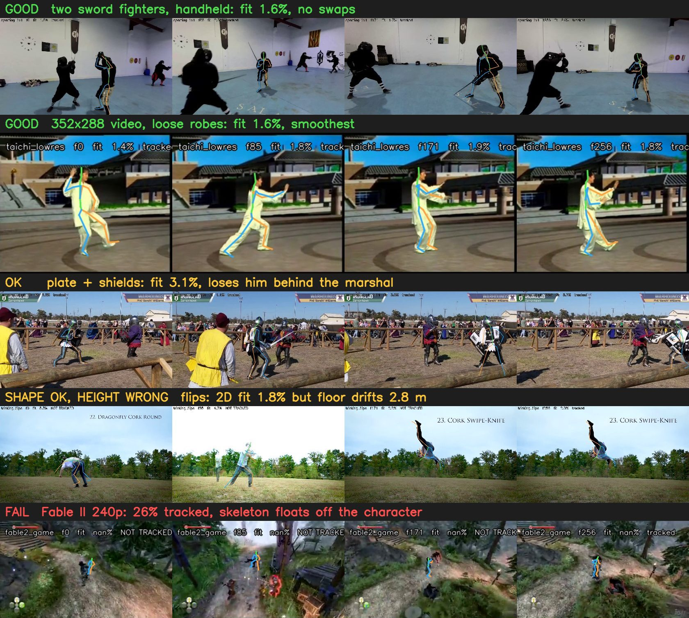

# GEM-X stress test: what it's good at, what it isn't (2026-11-22)

This is a private test. Every clip below came from YouTube and was downloaded for this test only. **None of the motion may ship.** For how to get motion you can ship, see section 6.

## 1. Bottom line

GEM-X is very good at **body pose** from footage of real people. On every real-person clip, the skeleton lay on the person to within about 1–3% of their height in the video. That held through armour, loose robes, 352×288 video, handheld cameras, two fighters and mid-air flips.

It is weak at **where the body is in the world**. That means root height, the floor, and jumps. It also loses the person at cuts, and it cannot see props or fingers.

| Works well | Struggles or fails |
|---|---|
| One person, whole body in frame, standing or stepping (fit 1.1–1.8%) | **Airborne moves.** Flips keep their shape but lose most of their height. The floor drifts up to 2.8 m |
| **Two fighters at close range.** It held one fighter for the whole 20 s with no swaps, even though both wore black | **Floor work.** Rolls and ground grappling float about 1 m unless re-grounded (the hip-escape run) |
| **Armour and shields.** It works, but the fit is about 2× worse (3.1%), and it lost the fighter for about 1 s when a marshal walked in front | **Edited footage.** Cuts, cross-fades and title cards break tracking, so a compilation tracked only 58–68% of its frames |
| **Low-resolution video** (352×288 tai chi): fit 1.6% and the smoothest result of the set | **Game footage (Fable II): fails outright.** Only 26% of frames tracked, fit 9–25% and 9× the jitter. Nothing usable came out |
| **Small figures in a wide shot** (stage combat): the smoothest motion of the set | **The camera solver** gave up on 2 of 9 clips: an orbiting game camera, and a tripod shot of plain sky. A real moving camera needs ViPE, a separate install |
| **Loose clothing** (tai chi robes, karate gi) | **Props.** No sword, staff or shield is tracked, so the weapon has to be re-attached and hand-keyed |
| **Handheld camera** with background mode (the sparring clip) | **Fingers.** Hands stay open; the hand model is a separate gated download |
| **Speed:** a 20 s clip takes 6.5–13.6 min on the shared 5080 | **Very fast spins** (staff twirls, tornado kicks): jerk is 2–3× higher, with some pops |

**For a fantasy game:**
- GEM-X is a fine tool for blocking out **grounded** sword, shield and stance animations, ambient motion and NPC idles from footage.
- It is not ready for acrobatics, rolls or anything that leaves the ground without hand clean-up.
- Clean-up is needed in every case: smoothing, foot locks, weapon attach and hands.

*Rows from top to bottom: sword spar (good), low-res tai chi (good), armoured duel (OK), flips (shape OK, height wrong), Fable II (fail). These are frames from the overlays in `C:\Users\zachc\GemXTest\stress\`.*

## 2. Test set

There were nine clips of 16–20 s each, picked to stress one thing each. The two earlier runs are included as baselines.

| Clip | What it stresses | Source (YouTube id) | Resolution | Camera mode |
|---|---|---|---|---|
| `00_longsword_solo` (baseline) | Clean case: one fencer, locked-off camera | HEMA 64-cut solo drill | 1080p30 | static |
| `01_hip_escape` (baseline) | Floor work | BJJ shrimp drill | 1080p30 | static |
| `sparring_1v1` | Two fencers at close range, handheld camera, near-identical black kit, segments in B&W | `yYuWEZMTI3s` | 1080p30 | background |
| `armored_duel` | Full plate and heater shields, crowd, marshal walking through the shot | `85RdV3gTVUY` | 720p60 | background |
| `tricking_flips` | Cork and swipe-knife flips, a compilation with cuts and title cards | `cslIbZERhSc` | 1080p30 | static |
| `tricking_kicks` | Hook kick, tornado kick, pop 180 (same video) | `cslIbZERhSc` | 1080p30 | static |
| `fable2_game` | **Game footage** (Fable II combat), 240p, game camera | `NPvlT8cQjng` | 424×240 | background → static (retry) |
| `bostaff_kata` | Staff spins, five near-identical people in white gi | `ooRhC63NxXs` | 1080p30 | static |
| `taichi_lowres` | 352×288 25 fps video, loose robes | `kzqjsVJgLTc` | 352×288 | background |
| `dive_roll` | Parkour dive roll, 60 fps, moving camera | `GHGUNOrW9RE` | 1080p60 | background → static (retry) |
| `stage_combat` | Two actors small in a wide shot, sword choreography | `BarTdapM9k4` | 1080p30 | background |

## 3. Numbers

Rows are sorted from best to worst. "GEM-X time" is for a 20 s clip on the RTX 5080, shared with the open editor.

| Clip | Verdict | Camera mode | GEM-X time | Tracked | 2D fit median / p90 (% box) | Jerk median (m/s³) | Pops | Contact foot speed | Airborne frames | Floor drift | Hips height p5/p50/p95 (m) |
|---|---|---|---|---|---|---|---|---|---|---|---|
| 00_longsword_solo | Excellent | static | 6 m 22 s (24 s clip) | 100% | 1.12 / 1.56 | 265 | 0 | 0.07 m/s | 0 | 0.34 m | 0.94 / 1.10 / 1.27 |
| taichi_lowres | Excellent | background | 13 m 03 s | 100% | 1.62 / 2.53 | 185 | 0 | 0.05 m/s | 0 | 0.04 m | 0.79 / 0.86 / 0.90 |
| stage_combat | Excellent | background | 12 m 52 s | 100% | 1.82 / 3.45 | 169 | 0 | 0.05 m/s | 0 | 0.19 m | 0.86 / 1.03 / 1.08 |
| sparring_1v1 | Very good | background | 7 m 11 s | 100% | 1.56 / 2.57 | 406 | 0 | 0.14 m/s | 0 | 0.18 m | 0.82 / 0.95 / 1.05 |
| bostaff_kata | Good body, no staff | static | 13 m 36 s | 100% | 1.65 / 3.61 | 726 | 2 | 0.21 m/s | 0 | 0.38 m | 0.79 / 0.96 / 1.23 |
| armored_duel | Usable, rougher | background | 8 m 02 s | 96% | 3.12 / 7.21 | 544 | 1 | 0.15 m/s | 0 | 0.19 m | 0.83 / 0.89 / 0.97 |
| tricking_kicks | Shape good, height off | static | 10 m 10 s | 68% | 1.54 / 3.61 | 544 | 69 | 0.21 m/s | 104 | 1.22 m | 0.85 / 1.72 / 2.14 |
| 01_hip_escape | Shape good, floats | static | 11 m 52 s (25 s clip) | 94% | 1.72 / 4.10 | 559 | 0 | 0.18 m/s | 332 | 1.11 m | 0.46 / 1.00 / 1.32 |
| dive_roll | Shape good, height off | static (retry) | 7 m 54 s (16 s clip) | 53% | 1.80 / 3.73 | 419 | 6 | 0.35 m/s | 186 | 2.39 m | 0.66 / 1.93 / 2.40 |
| tricking_flips | Shape good, height wrong | static | 6 m 31 s | 58% | 1.79 / 3.08 | 815 | 60 | 0.30 m/s | 186 | 2.79 m | 0.91 / 1.70 / 3.54 |
| **fable2_game** | **Fail** | static (retry) | 8 m 11 s | **26%** | **8.86 / 25.07** | **2372** | 24 | **0.97 m/s** | 38 | 0.88 m | 0.63 / 1.12 / 1.66 |

- No clip had a track-ID switch.
- Hips heights are measured above each clip's lowest floor estimate. A p50 well above 1 m (flips, kicks, dive roll) is floor drift, not real height.

**How to read the columns:**
- **2D fit:** how far the GEM-X skeleton, projected back onto the video, sits from the keypoints the detector saw. It is a percentage of the person's box size. Under 2% looks glued on; above 5% is visibly off.
- **Tracked:** the share of frames where the primary person was found. Untracked frames are filled in by GEM-X and are usually wrong.
- **Jerk:** the median joint jerk in m/s³. It is a noise measure, but fast real motion raises it too. For reference, a clean Kimodo render scores 286.
- **Pops:** frames where a joint moves faster than 10 m/s, which is a likely glitch.
- **Contact foot speed:** how fast a foot slides while GEM-X says it is planted. Lower is better; above 0.15 m/s shows as foot skate.
- **Airborne frames / floor drift:** frames with both feet more than 20 cm above a rolling 2 s floor, and how far that floor wanders. Drift above about 0.5 m means the world-space height is unreliable.

## 4. Findings, one axis at a time

### Two fighters (`sparring_1v1`)
This is the best surprise of the set.
- Two people in matching black kit, a handheld camera and cuts to black-and-white.
- It stayed on the same fencer for all 600 frames with zero track switches.
- The fit was 1.6%, there were no pops, and foot speed was 0.135 m/s.
- On the Hero it reads as a real longsword bout: guard changes, a passing step in, a cut, and recovery.
- **What you get is one fighter.** To get the opponent you run the clip again with that person picked; GEM-X follows one person per run. The two runs are not synced to each other as a paired animation, so a scripted duel needs alignment by hand.

### Armour and shields (`armored_duel`)
- It works. The legs and stance are right, and the shield arm is held forward.
- The fit is about 2× worse than unarmoured fencers (3.1% median, 7.2% p90). Plate hides the joints, so the detector guesses elbows and knees.
- When the marshal crossed in front, it lost the fighter twice (frames 215–231 and 260–279), and those frames are guesses.
- The postprocessed foot speed (0.15 m/s) is borderline.
- **For Giltside soldiers:** usable for the stance and shield-carry base. Expect to re-key the arms.

### Flips and kicks (`tricking_flips`, `tricking_kicks`)
- **2D shape is excellent.** The inverted cork and the tornado-kick extension sit right on the athlete (fit 1.5–1.8%).
- **3D height is not.**
  - In the GEM-X world output the lowest joint is only about 0.5–0.9 m off the floor at the top of the cork. On video the athlete's feet are well over a metre up.
  - The floor itself drifts 2.8 m over the clip.
  - After grounding, the Hero does the cork mostly at floor height, so it looks more like breakdancing than a flip.
- **Kicks** are usable: the tornado kick has a short hop and the hook kick stays grounded.
- Pops: 60–69 frames each, mostly at cuts and title cards in the compilation, which also caused the 58–68% coverage.
- **Lesson:**
  - Use single-move, uncut footage.
  - Expect to hand-key or simulate the root height of anything airborne.
  - GEM-X's own contact labels can't fix this. Around the cork they report no foot or hand contact for 2.6 s (frames 461–539). A real flip is under a second in the air, so the labels are as confused as the root.

### Low resolution and loose clothing (`taichi_lowres`)
- 352×288 at 25 fps, with flowing robes and a busy background.
- Fit 1.6%, the lowest foot speed of the set (0.05 m/s), and the second-lowest jerk (185). Floor drift was only 4 cm.
- Resolution and baggy clothes are *not* the problem; occlusion, cuts and props are.

### Staff spins and look-alikes (`bostaff_kata`)
- It stayed on the right student among five in identical white gi, while they moved in formation.
- The body is right, but staff spins push jerk to 726 with 2 pops. Foot speed is 0.21 m/s (sliding).
- The staff is not tracked, so the spin is only the arms.

### Small figures in a wide shot (`stage_combat`)
- The actors are about 150 px tall in a 1080p frame.
- Fit 1.8%, the smoothest motion of the set (jerk 169), and planted feet (0.05 m/s).
- Choreographed, slower stage fights are ideal input.

### Game footage (`fable2_game`)
**This fails, and it is the clearest failure in the set.**
- **The input:** a 20 s Fable II combat clip, the only copy available at 424×240.
  - The hero is about 40 px tall under a high, orbiting third-person camera.
  - The frame also has hit flashes, magic particles, enemies with red outlines, a HUD and a full-white flash frame.
- **First attempt (`background` camera mode):** it ran for 16 min and then stopped, because the camera solver couldn't follow the orbiting game camera.
- **Re-run as `static`:**
  - The detector found the hero in only **26% of frames**, in short bursts of 11–31 frames.
  - The 2D fit is 8.9% median and **25% at p90**. Looking at the overlay, the skeleton often floats beside the character or over empty grass.
  - Jerk is 2372, which is 9× the clean case, with 24 pops. Feet slide at 0.97 m/s.
  - Nothing usable came out, so I didn't put it on the MetaHuman.
- **Why:**
  - GEM-X's detector and pose model are trained on real people. A tiny stylised game character is barely a "person" to them.
  - The game's own camera adds motion and effects the model never sees in real video.
  - Higher-resolution captures with the camera zoomed in would do better. Even then you'd only get a noisy copy of keyframe animation that already exists in the game (see section 6).

### Camera-mode failures (`dive_roll`, and the first `fable2_game` attempt)
- GEM-X's built-in "background" camera solver matches background features from frame to frame. It **refused both clips**: "Background camera tracking was unavailable for more than one second".
  - For Fable II the cause was the orbiting game camera.
  - For the dive roll, the camera was actually on a tripod. The shot is mostly plain sky and lawn, with too little texture to match.
  - Each failure cost time before the error: 16 min and 5 min.
- **Rule of thumb:**
  - Use `static` for any tripod shot, even when the background is busy.
  - Use `background` only for handheld or panning shots with textured backgrounds; it worked on the sparring, duel, tai chi and stage clips.
  - For real camera moves, the fix is NVIDIA's ViPE camera estimator. It is a separate install that I didn't do.
- **Dive roll as `static`:**
  - The pose is right through the run-up, the dive, the handstand-to-roll and the recovery (fit 1.8%).
  - It has the same weakness as the flips: floor drift of 2.4 m, 186 airborne frames, and feet sliding at 0.35 m/s.
  - Only 53% of frames were tracked, because the tutorial cuts to the presenter talking. Tracking stopped at the second cut, about 8.4 s in.

## 5. On the MetaHuman

Three clips went through the full pipeline: GEM-X → SOMA → `RTG_SomaToHero_Video` → Hero body. They are in `/Game/Animation/VideoTests/`. The assets are new, saved, and not committed. `Content/Animation/` is untracked.

| Asset | Length | Recording (`Saved/Recordings/`) | What it looks like |
|---|---|---|---|
| `AS_Hero_GemX_Sparring1v1` | 20.0 s | `Viewport_20261122-024717_CAAS9WFLRWHCCIZMNE275S539.mp4` | Convincing longsword bout footwork: guard, pass, cut, recover. The pelvis stays at 77–85 cm. |
| `AS_Hero_GemX_ArmoredDuel` | 20.0 s | `Viewport_20261122-024759_AJ1GKUOY7GAJXGY0MTUX0L14L.mp4` | A wide fighting stance with the shield arm forward and circling steps. At about 13 s the hands drop while the fighter is occluded. |
| `AS_Hero_GemX_TrickingFlips` | 11.5 s | `Viewport_20261122-024831_1NQX2GUMC2VEVDWBIC2PB6K6S.mp4` | The flip shapes are there (inverted, twisting), but close to the floor, and the root wanders out of frame early. This is the failure case. |

- The recordings ran at about 12 fps because GEM-X was using the GPU at the same time. They play at the right speed.
- They show the body mesh only, with no head, clothes or weapon.

## 6. Game clips such as Fable II vs videos of people

- **The test answered this.** The Fable II clip is the only one in the set with no usable output. Every real-person clip produced at least a usable body shape (section 4).
- **Technically:** game footage is a harder input than a phone video of a person.
  - It is low resolution after YouTube compression.
  - It has a HUD, a camera that orbits the player, and cuts.
  - Characters move with game-animation timing, including blends and hit-pauses. GEM-X then smooths this into something between the original animation and noise.
  - A game's camera also defeats the background camera solver (see section 4).
  - What you'd recover is a blurry copy of animation that already exists as clean keyframes inside the game.
- **Legally (not legal advice):** this is the riskier of the two sources.
  - Fable II's combat animations are authored, copyrighted works owned by Microsoft (Lionhead).
  - Extracting them from footage and putting them in a commercial game copies that work, even after it is re-solved onto a new skeleton. The game's EULA also forbids reverse engineering.
  - Recognisable signature moves make the copy easy to spot.
  - A real person's motion in a YouTube video is less clear-cut: the video is copyrighted, but a plain movement mostly isn't. Even so, Research.md section 5 still says don't ship it.
- **Recommendation:** use game footage only as **reference** for timing and feel. Re-perform the moves yourself and film them for GEM-X, or block them out in Kimodo.

**How to get shippable motion from GEM-X:**
1. **Film yourself or a hired performer** with a release. Use a locked-off phone at 1080p30–60 with the whole body in frame and a plain background. Do one move per take with no cuts. Wear fitted clothes and carry a prop the same length as the game weapon. This is the case GEM-X handles best: the longsword baseline scored fit 1.1% and jerk 265.
2. **Keep it grounded.** Do footwork, cuts, blocks, stances, shield work, ambient and idle motion with GEM-X. Hand-key or simulate jumps, rolls and flips, or use GEM-X only for the airborne shape and key the root height by hand.
3. **Clean up after the solve:**
   - a light filter on joints (jerk is 1.5–3× Kimodo's);
   - foot locking from GEM-X's own contact labels;
   - a weapon socket on `hand_r` with wrist correction;
   - hand poses from a grip library.
4. **One performer per run.** For paired moves, film both performers and run GEM-X once per person, then align the two clips by hand in Sequencer.
5. **Budget about 30× real time** on the 5080 with the editor open, so roughly 10 min per 20 s clip. Run batches with the editor closed.

## 7. Files

All in `C:\Users\zachc\GemXTest\` (outside the repo):
- `stress\<clip>_overlay.mp4`: the GEM-X skeleton drawn over the source video, with per-frame fit and tracked status.
- `stress\<clip>_sheet.jpg`: 8 frames of that overlay.
- `stress\<clip>_metrics.json`: the numbers in section 3.
- `stress\batch.log`: the batch log.
- `stress\<clip>_scan.jpg`: 18–24 time-stamped frames for the armoured duel, bo staff, Fable II and dive roll.
- `preview\<clip>_mh_scan.jpg`: 12 frames from each MetaHuman recording.
- `ArtDirection/VideoToAnim/stress_summary.jpg`: the good-to-bad image at the top of this report.
- Scripts:
  - `scripts\analyze_clip.py`: scoring and overlay.
  - `scripts\stress_batch.sh`: the batch runner. It waits for `PIE_LOCK` and takes a clip list.
  - `scripts\summarize.py`: the metrics table.
  - `scripts\gemx_to_soma30.py --ground=rolling`: keeps airborne frames.

Shared-editor footprint:
- Editor calls were made only while `Saved/PIE_LOCK.json` was absent and there were no PIE worlds.
- I created and saved only my own assets under `/Game/Animation/VideoTests/`. Asset editors were closed afterwards.
- No level changes, no PIE.
- `Saved/PIE_QUEUE.md` has NOTICE and DONE lines for every GPU batch.
