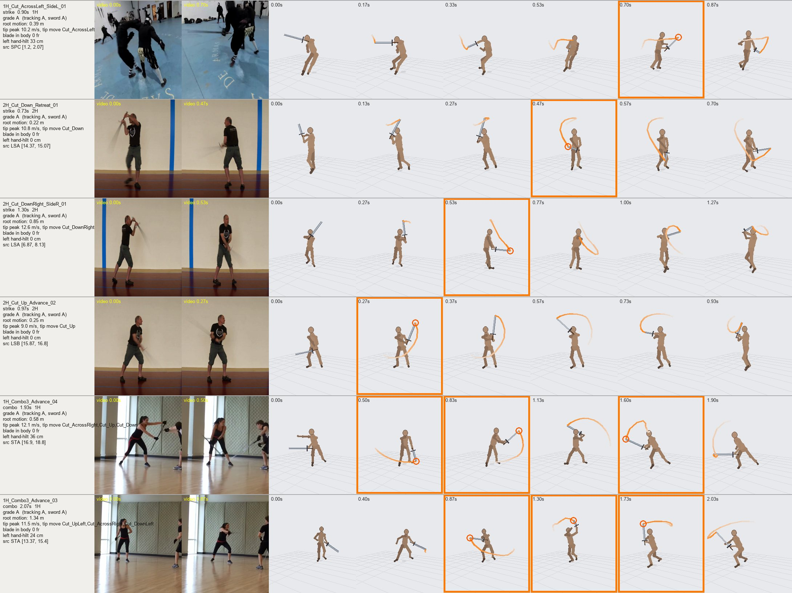

# Sword-fighting animation library from video (GEM-X)

Written 2026-11-22. Follows [Cleanup.md](Cleanup.md) and [StressTest.md](StressTest.md).

> **Licence warning.** Every move here was solved from YouTube footage (HEMA drills, sparring, stage combat, an armoured tournament). It is a **private placeholder library** for prototyping combat. None of it may ship, be uploaded or be shown publicly. Re-shoot the moves you keep with your own performer and run the same scripts (last section).

## What you get

There are **207 sword moves on the Hero**, cut from about 3 minutes of real footage. **192 are usable**, about 3.9 minutes of animation in all. 15 sit in `_Review`: 10 failed an automatic quality gate and 5 more were rejected in visual QA.

| Folder | Moves | What |
|---|---|---|
| Cuts | 113 | 20 descending to the left, 19 rising straight up, 18 rising to the right, 15 straight down, 12 rising to the left, 11 across to the right, 10 across to the left, 8 descending to the right |
| Thrusts | 0 | The 3 detected thrusts failed QA (see Known problems) |
| Combos | 26 | 2–3 cuts with no pause between them |
| Footwork | 40 | Steps forward, back and to each side, with the sword held |
| Guards | 13 | Held guards, trimmed to loop |

- **Hands:** 84 usable moves are two-handed (longsword) and 108 one-handed (sword-and-shield, stage combat, and one-handed moments in sparring).
- **Length:** 1.1 s median, from 0.7 s (10th percentile) to 2.0 s (90th).
- **Root motion:** 176 usable moves travel and carry root motion. A strike moves the fencer about 46 cm (median), because real fencers step as they cut.
- **Every clip has:** a gripped sword hand, the wrist correction, a hit notify and a swing sound. Two-handed clips also have the left hand on the hilt.
- **Montages:** one per clip, ready to play on the Hero's `DefaultSlot`.

**Sources** (all private-test only):

| Take | Footage | Moves |
|---|---|---|
| LSA, LSB | HEMA longsword cutting drill (solo, tripod), 2 × 24 s | 60 |
| SPA, SPB, SPC, SPE | Longsword sparring (handheld), 4 × 17–20 s | 78 |
| STA, STB | Stage combat, one-handed sword, 2 × 20–23 s | 44 |
| ADA | Armoured sword-and-shield bout, 20 s | 25 |

Three more sparring segments were planned but not solved. One failed when the machine ran low on RAM. I stopped the other two after the shared editor crashed from running out of GPU memory.

## Where it is in Unreal

All under `/Game/Animation/SwordLibrary/` (new, saved, our own assets; nothing else touched):

| Folder | What |
|---|---|
| `Hero/Cuts` | Single strikes on the Hero (`AS_Hero_Sword_*`) |
| `Hero/Combos` | 2–3 strikes chained with no pause |
| `Hero/Footwork` | Advances, retreats and side steps with the sword held in guard |
| `Hero/Guards` | Guard idles trimmed to their best loop |
| `Hero/_Review` | Moves that failed a quality gate (kept for reference; don't use) |
| `Montages/<same folders>` | One `AM_Sword_*` montage per clip, slot `DefaultSlot`, blend in 0.12 s / out 0.2 s |
| `Soma/` | The cleaned source clips on the SOMA skeleton (pipeline intermediates) |

**Names:** `AS_Hero_Sword_<1H|2H>_<move>[_<travel>]_<NN>`
- `1H` / `2H`: one-handed (sword and shield, stage combat) or two-handed (longsword).
- Move: `Cut_Down`, `Cut_Up`, `Cut_DownLeft`, `Cut_UpRight`, `Cut_AcrossLeft`, … named by what the **sword tip** does at the hit, seen from the Hero (Left/Right = the Hero's left/right). `Thrust`, `Combo2`, `Combo3`, `Step_Forward/Back/Left/Right`, `Guard_Idle`.
- Travel: `_Advance`, `_Retreat`, `_SideL`, `_SideR`, `_Shift` (under 12 cm) when the move carries root motion; no suffix = in place.

**In every clip:**
- **Root motion** is on when the move travels (more than 12 cm); the move starts at the origin facing +Y.
- **Hit notify** (`Spell Release`, the game's own `UReflectionsSpellReleaseNotify`) on track `Hit`, at the peak sword-tip speed of each strike. The existing cast code already reads this notify (`FindReleaseNotify`).
- **Swing sound** (`SCue_Sword_Swing`) on track `Swing`, 0.15 s before each hit.
- **Sword grip** keyed on both hands, and the **wrist correction** below baked into `hand_r`.

## The temporary sword and how it tracks

**Sword:** `/Game/LanthorneAssets/Frostside/Props/SM_Frostside_MirrorSword`, the only sword mesh in the project (98 cm, a hand-and-a-half sword). It's a stand-in.

**Attach transform** (component attached to the Hero body's bone `hand_r`, snap to target):
- Location (-2.97, 3.48, -5.07) cm
- Rotation: Pitch 59.13, Yaw -158.21, Roll 128.29
- What it means: the handle passes through the fist about 6 cm below the crossguard, runs 15° diagonally across the palm (pinky side toward the pommel), and the true edge faces the knuckles. The blade leaves the fist on the thumb side.

**Why a wrist correction is baked into every clip.** GEM-X can't see the sword, so the wrist it gives is a guess. With a plain grip, the blade went through the Hero's head in about half of the moves: high guards hold the hands in front of the face, and a blade at 90° to the forearm then points straight through it. Real fencers bend the wrist so the blade continues the forearm line. A search over grip angles (`sword_fit.py`) found that tilting the sword about 40° toward the forearm line fixes it. That tilt is split in two:
- **25° of ulnar deviation plus 5° of forearm roll, baked into `hand_r`** in every clip, so the fingers stay wrapped round the handle;
- **15° of diagonal in the grip itself**, part of the attach transform above.

On the first 124 moves this took moves with the blade through the body from 62 to 2. The fist, the grip and the sword all rotate together, so this changes no other bone.

**Left hand on the hilt (two-handed moves).** GEM-X's left hand floats about 13 cm off the handle in longsword moves, because it can't see where the handle is. `lefthand_ik.py` puts the left fist on the grip just below the right hand, wrapped the same way (palms facing each other, both index fingers toward the blade, knuckles toward the edge). It moves the left arm with two-bone IK, keeping the elbow on its original side. It only applies on frames where the fencer's left hand was already near the handle: full strength under 18 cm, fading out by 35 cm. So one-handed moments inside a longsword move keep their free left hand.

**How it tracks** (all 207 moves, measured on the Hero mesh's own proportions, every frame):

| Check | Result |
|---|---|
| Blade passes through the Hero's own body | 7 moves (head 4, thigh 3, shin 2); it was about half the moves before the wrist fix |
| Sword tip goes under the floor | 2 moves |
| Left fist to the handle, two-handed moves | median 0.0 cm, 90th percentile 3 cm (it was about 8 cm before the left-hand fix) |
| Sword-tip speed | median of per-move peaks 6.3 m/s, 90th percentile 10.9 m/s |

These real-fencing tip speeds read as fast but not superhuman. Scale with the montage play rate if you want snappier game timing.

## Using a move in the game

Nothing is wired into gameplay yet (that needs a `Source/` change and a rebuild). The pieces are ready for it:

1. **Attach the sword** to the Hero's body mesh at the **bone** `hand_r` with the relative transform in the section above. Do it in code or in the Hero Blueprint, not as a socket on `metahuman_base_skel` (the shared skeleton must not be saved casually). In C++:
   ```cpp
   Sword->AttachToComponent(Body, FAttachmentTransformRules::SnapToTargetNotIncludingScale, TEXT("hand_r"));
   Sword->SetRelativeTransform(SwordInHand);   // the location/rotation above
   ```
   The wrist correction is already baked into every clip, so the attach transform is the same for all of them.
2. **Play a move** as a slot montage on `DefaultSlot`, the slot the Hero already uses for spells (`UReflectionsHeroAnimInstance::SpellSlot`). The quickest test is the existing external-cast path: `UReflectionsSampleSpellDriver::CastExternal` with `Animation` = a clip, `ReleaseTime` = its hit time and `OnRelease` = the damage trace.
3. **Hit timing.** Each strike's `Spell Release` notify marks the hit, so code that already calls `FindReleaseNotify` gets the hit time for free. For a proper melee system, trace the blade (guard → tip) for a few frames either side of that notify.
4. **Root motion.** Moves that travel have root motion on. The Hero's body plays casts through a separate retarget Body component, so check that root motion from that component actually moves the capsule; if it doesn't, play travelling moves with root motion off and move the capsule in code, or use only the in-place moves at first.
5. **Chaining.** Moves start and end wherever the fencer was, not in one shared guard. Montage blends (0.12 s in, 0.2 s out) hide most seams. For a combo system, pick moves whose end pose matches the next one's start, or cross-fade from a `Guard_Idle` clip.

## How it was made

All scripts are in `C:\Users\zachc\GemXTest\scripts\` (outside the repo). Everything except the Unreal steps runs without the editor.

1. **Footage.** The four videos already on disk from the stress test, cut into 12 takes of 20–24 s: the HEMA longsword cutting drill (2 takes, tripod), longsword sparring (7 takes, handheld), stage combat (2 takes) and the armoured sword-and-shield bout (1 take). GEM-X solved the 8 new takes on the GPU in the background (`lib_batch.sh`, about 10 min per take). No new downloads.
2. **Clean the whole take** (`clean_motion.py` passes, see Cleanup.md): despike, per-body-part smoothing, a floor from planted feet, foot lock with leg IK, a smooth root. Cleaning before cutting keeps the filters away from the cut edges.
3. **Cut moves** (`build_library.py`):
   - **Strikes:** peaks of right-hand speed relative to the chest. Each is cut from the quietest frame before it to the quietest frame after it, then padded by 3 frames (0.5–2.5 s).
   - **Combos:** 2–3 strikes with no pause between them (the hands never slow below 0.9 m/s).
   - **Footwork:** a foot lifts and lands with at least 20 cm of travel and no strike.
   - **Guards:** at least 1.2 s of stillness, trimmed to the pair of frames whose poses match best, so it loops.
   - Each move is turned to face +Y (the direction the hands point toward the opponent, blended with the torso), moved to the origin, and given root motion only if it travels.
   - **Quality gates:** moves with less than 80% of frames tracked, or more than two pops, are dropped; under 90% tracked is grade C.
4. **Unreal** (`lib_ue.py`, short async calls to the shared editor): import to SOMA → batch retarget with `RTG_SomaToHero_Video` → key the sword grip on both hands → bake the wrist correction into `hand_r` → dump every frame's bone positions → bake the left-hand fix → dump again.
5. **Sword tracking** (`sword_report.py`): rebuild the sword from the dumps and score each move (below). Name each strike from its tip path and place the hit at the tip-speed peak.
6. **Finalize** (`lib_ue.py finalize`): rename into the folders above, add hit and swing notifies, build the montages.
7. **Review media** (`render_moves.py`): frame-exact renders of the Hero skeleton with the sword, next to the source video.

## Visual QA

Four reviewer agents checked every move against its source video, working from the review sheets: two video frames next to six frames of the Hero with the sword and a tip trail. The result: **109 good, 86 OK, 12 reject.**
- Seven of the 12 rejects were already in `_Review` from the automatic gates, so the two checks agree.
- The other 5 were moved to `_Review`:
  - all three "thrusts" (a low slash and two raised guards, not thrusts);
  - two hunched, grapple-like steps from the armoured bout.
- Each verdict, issue tag and note is in `SwordLibrary.csv` (`qa_*` columns).

Common minor flags:
- `blade_wrong_for_cut`: 17 moves where the blade angle looks odd for the action, mostly one-handed sparring cuts. This is the wrist-from-video limit.
- `cut_off`: 7 long clips that end in a crouch.
- `name_wrong`: 2 `Cut_UpRight` clips that look more like `Cut_AcrossRight`.

## Known problems

- **Private placeholders only.** The footage is other people's (see the licence warning).
- **No real thrusts.** The drills and bouts are cut-heavy, and the three detected thrusts failed QA. The `Thrusts` folder is empty. Film thrusts on purpose for the next pass.
- **Wrists are approximate.** GEM-X has no sword to look at, so the blade angle is reconstructed: a fixed grip plus one wrist correction for all moves. Expect to touch up the wrist on the key frames of moves you keep (QA flagged 17 as odd-looking).
- **Moves start and end wherever the fencer was.** There's no shared neutral guard, so chain them with montage blends, or pick moves whose ends match.
- **Most moves travel** (median 46 cm per strike). That is realistic for HEMA, but you'll want in-place versions for some game uses. Removing travel after the fact makes feet slide, so it's better to film in-place takes.
- **Direction names are automatic.** They come from the tip path in the Hero's own frame. QA found 2 wrong out of 121 strikes, and borderline diagonals can go either way.
- **One-handed sparring moves** sometimes keep the free hand in odd places, because the original fencers were two-handed and let go.
- **Shield work:** the armoured clips keep a raised left arm with no shield in it. They need a shield attached to `hand_l` (or `lowerarm_l`) to read properly.
- **The Hero mesh in previews is the body only.** The game Hero has clothes, so check for clipping with the real outfit.

## Review media



*Each row is one move: two frames of the source video, then six frames of the Hero with the sword and the sword-tip trail. An orange border marks the hit.*

These renders are drawn offline from the Hero's exact per-frame bone data and the sword's attach transform. They are not editor captures: the shared editor's animation preview didn't re-pose reliably while other sessions loaded it, and editor captures add GPU load. The body is a capsule mannequin, so judge the motion and the sword, not the mesh.

All in `C:\Users\zachc\GemXTest\library\review\`, each with the source video on the left:
- `SwordLibrary_Highlights.mp4` (37 s): 26 of the best moves, two of each cut direction plus combos, guards and steps. **Watch this first.**
- `SwordLibrary_Cuts.mp4` (2 min 41 s): every strike, including the `_Review` ones (grade shown in the title bar).
- `SwordLibrary_Combos.mp4`, `SwordLibrary_FootworkGuards.mp4`.
- `..\qa\sheets\page_00.jpg` … `page_41.jpg`: the QA sheets, 5 moves per page.

**The catalogue:** [SwordLibrary.csv](SwordLibrary.csv) has one row per move:
- asset and montage path;
- folder, hands, length, hit times;
- root motion and travel;
- grades and sword metrics;
- QA verdict, issues and note;
- source take and timecode.

## Files

**Unreal** (new, saved, our own assets; nothing else touched): `/Game/Animation/SwordLibrary/`
- 207 `AS_Hero_Sword_*` and 207 `AM_Sword_*`;
- 207 `AS_Soma_Sword_*` source clips.

**Repo** (`ArtDirection/VideoToAnim/`, not committed):
- this file;
- `SwordLibrary.csv`;
- `sword_library_sheet.jpg`;
- `SwordCombatPatch.md` + `sword_combat_test.patch`: a ready-to-apply gameplay test, **not applied**.

**Outside the repo** (`C:\Users\zachc\GemXTest\`):
- **Scripts** in `scripts\`: `build_library.py`, `lib_ue.py`, `lib_takes.sh`, `lib_batch.sh`, `sword_fit.py`, `lefthand_ik.py`, `make_grip_geom.py`, `sword_report.py`, `qa_merge.py`, `catalog_export.py`, `render_moves.py`, `clean_motion.py`.
- **Data** in `library\`:
  - `moves.json`, the master catalogue;
  - `sword_report.json`, `grip_fit.json`, `grip_geom.json`, `lefthand_report.json`;
  - `dumps\` (per-frame Hero bone data), `qa\`, `review\`.

## Gameplay test patch (prepared, not applied)

`sword_combat_test.patch` adds one self-contained component, `ReflectionsSwordTest`, and a 3-line hook in `ReflectionsSampleGameMode.cpp`, so the player Hero gets it at spawn. `git apply --check` passes on the current tree. Details are in `SwordCombatPatch.md`. In short:
- **X** draws or puts away the temp sword. While it's out, **LMB / Q / RT** plays the next cut (hold to chain), and **F** plays the next combo. Spells work as before while the sword is away.
- The blade is swept from guard to tip around each Hit notify, and hits are drawn on screen. Damage is optional (`Sword.Damage`).
- **Root motion:** a montage on the Hero's Body component doesn't move the capsule (the character's own mesh is the GASP mesh). So the component moves the capsule from the Body's root motion; `Sword.RootMotion 0` plays moves in place instead.
- **Applying it:** it needs `Source/` changes and a full build with the editor closed (a build-train window). It also edits a file the digging work touched.
- **Removing it:** `Sword.Test 0` disables it, and `git apply -R` removes it.

## Adding more moves / the shippable path

The same scripts take any new footage. For moves you can ship, film your own performer (see Cleanup.md, "The shippable path"): a tripod, the whole body in frame, one move per take starting and ending in guard, and a wooden sword of the right length.

```powershell
cd C:\Users\zachc\GemXTest
# 1. add a line "key|video.mp4|start_s|end_s|static" to library\src\list.txt, then solve on the GPU (~10 min per 20 s)
bash scripts/lib_batch.sh
# 2. add the take to SOURCES in scripts\build_library.py, then cut it
.venv\Scripts\python.exe -I scripts\build_library.py NEWKEY
# 3. Unreal: import, retarget, grip + wrist, left hand, dumps (editor open, no PIE)
bash scripts/lib_takes.sh NEWKEY
# 4. score, name, finalize, export, render
.venv\Scripts\python.exe -I scripts\sword_report.py
.venv\Scripts\python.exe -I scripts\lib_ue.py finalize --take NEWKEY
.venv\Scripts\python.exe -I scripts\catalog_export.py
.venv\Scripts\python.exe -I scripts\render_moves.py reel library\review\new.mp4 --source
```

Final names are numbered across the whole library, so run `finalize` for all takes together (`--all`) when you add takes, or new numbers may collide.
